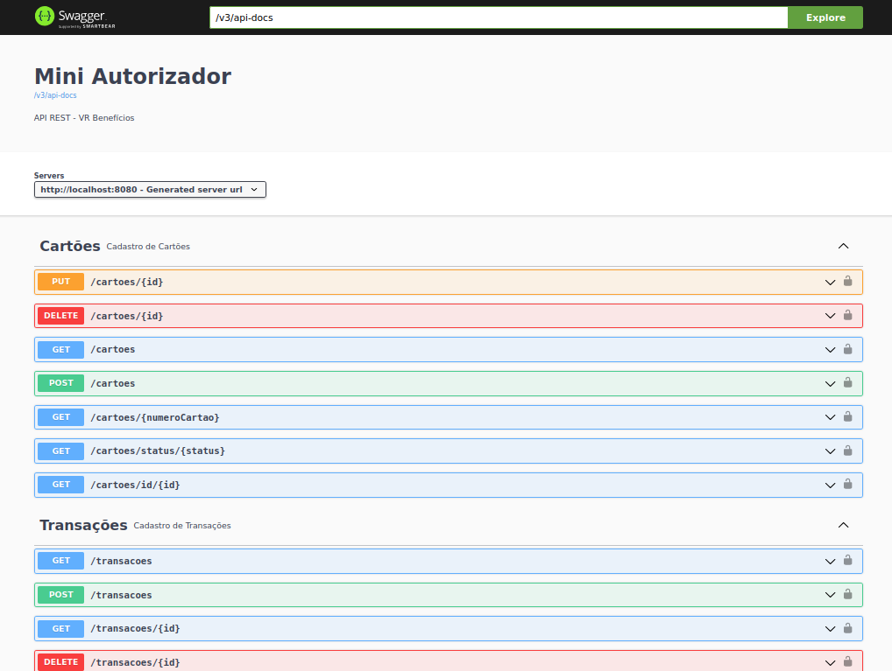
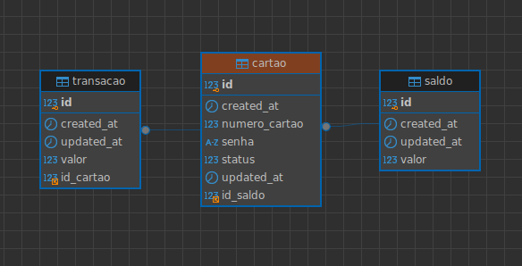
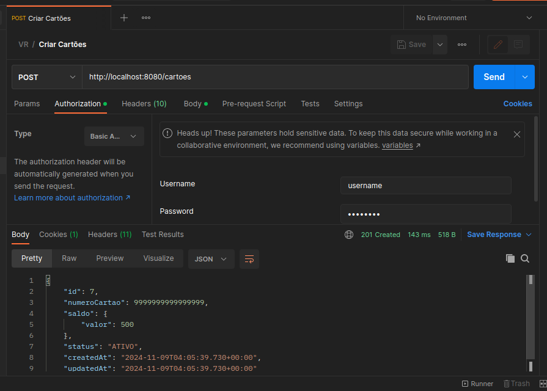
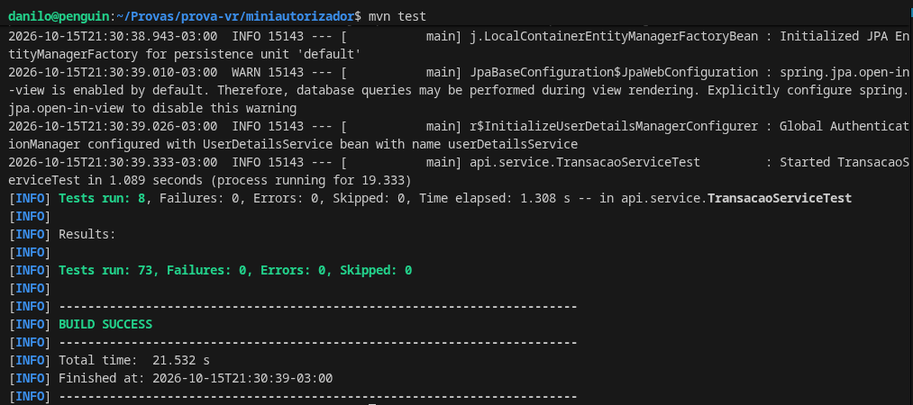
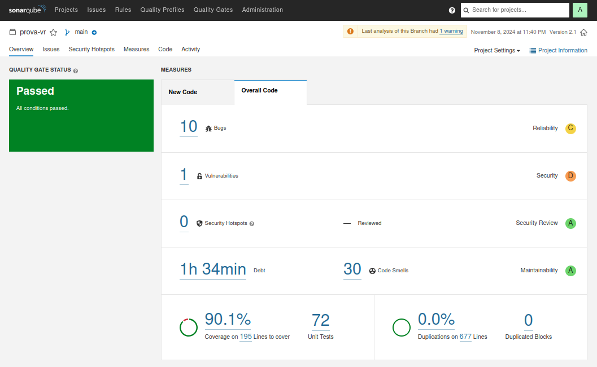
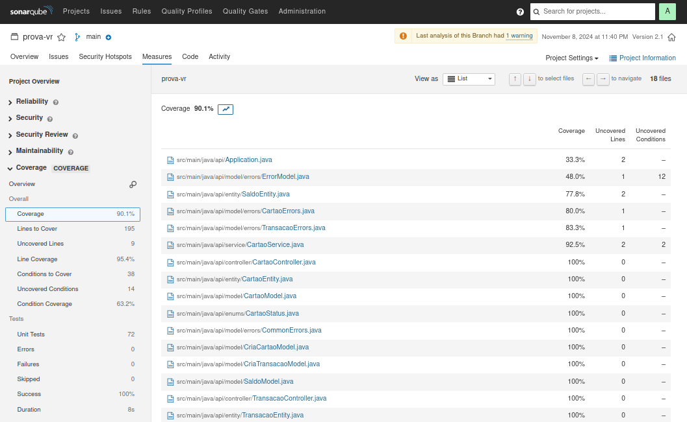

# Prova VR

Avaliação técnica de uma API de Mini Autorizador, desenvolvido em Java com Spring-Boot.


## Características

- CRUD
- API RESTful
- Basic Auth
- Validation
- Enum
- Exception
- MockMVC


## Requisitos

- Java JDK 17
- Apache Maven >= 3.8.6
- MySql 8
- Docker (Opcional)


## Tecnologias

- Java
- JPA
- Maven
- Spring
- Lombok
- Swagger
- H2
- JUnit
- SonarQube
- Docker


## Instalação

```
$ git clone https://github.com/danilomeneghel/prova-vr.git

$ cd prova-vr
```

## Maven

Para rodar o projeto com Maven, é necessário ter a versão 3.8.6 instalada.<br>
Além disso, é preciso ter o Java 17 e o MySql 8 instalado.<br>

Tendo tudo instalado e rodando localmente, basta executar o seguinte comando:

```
$ cd miniautorizador
$ mvn clean install -U
$ mvn spring-boot:run -Dspring-boot.run.profiles=dev
```

Caso não tenha o Maven instalado ou tenha outra versão, pode usar o comando ./mvnw (no Linux) ou mvnw.cmd (no Windows).


## Docker (Opcional)

O arquivo `docker/docker-compose.yml` foi mantido exatamente como disponibilizado no
desafio: contém os dois bancos de dados (MySQL ativo e MongoDB comentado), **sem
alterações na declaração do banco selecionado (MySQL)** e **sem serviços adicionais**
(o SonarQube, por exemplo, não faz parte do compose).

Para subir apenas o banco de dados MySQL:

```
$ cd docker
$ docker-compose up -d
```

O MySQL ficará disponível em `localhost:3306`, banco `miniautorizador`, usuário `root`
sem senha. Em seguida, suba a aplicação via Maven (perfil `dev`), que já aponta para
esse banco:

```
$ cd miniautorizador
$ mvn spring-boot:run -Dspring-boot.run.profiles=dev
```

A API ficará disponível em `http://localhost:8080`.

Para encerrar o banco:

```
$ docker-compose down
```


## Swagger 

Documentação da API RESTful: <br>

http://localhost:8080/swagger-ui.html

Login:
  - Usuário: username
  - Senha: password


## SonarQube (Opcional)

A análise de qualidade e cobertura via SonarQube é **opcional** e **não faz parte do
`docker-compose.yml`** (que contém somente os bancos de dados, conforme o desafio).
Caso queira utilizá-la, suba uma instância própria do SonarQube (por exemplo, com
`docker run -p 9000:9000 sonarqube:9.9.7-community`), gere um token e execute:

```
$ cd miniautorizador
$ mvn clean verify sonar:sonar \
  -Dsonar.projectKey=NOME_PROJETO_GERADO \
  -Dsonar.host.url=http://localhost:9000 \
  -Dsonar.login=TOKEN_GERADO
```

## Testes

Para realizar os testes, execute o seguinte comando no terminal:

```
$ cd miniautorizador
$ mvn test
```

Os testes usam JUnit 5, Mockito e MockMvc, com o banco H2 em memória no perfil `test`
(`src/test/resources/application-test.properties`).


## Contratos implementados

Os contratos do enunciado são respeitados exatamente.

### Criar cartão
- `POST /cartoes` — Basic Auth (`username` / `password`)
- Corpo: `{ "numeroCartao": "6549873025634501", "senha": "1234" }`
- `201` → `{ "senha": "1234", "numeroCartao": "6549873025634501" }`
- `422` (cartão já existe) → `{ "senha": "1234", "numeroCartao": "6549873025634501" }`
- `401` sem autenticação válida

### Obter saldo
- `GET /cartoes/{numeroCartao}` — Basic Auth
- `200` → saldo como número (ex.: `495.15`)
- `404` sem corpo quando o cartão não existe
- `401` sem autenticação válida

### Realizar transação
- `POST /transacoes` — Basic Auth
- Corpo: `{ "numeroCartao": "6549873025634501", "senhaCartao": "1234", "valor": 10.00 }`
- `201` → `OK`
- `422` → `SALDO_INSUFICIENTE` | `SENHA_INVALIDA` | `CARTAO_INEXISTENTE`
- `401` sem autenticação válida

> Observação: no corpo da transação o campo da senha é **`senhaCartao`**, exatamente
> como definido no contrato (diferente de `senha`, usado na criação do cartão).


## Suposições e decisões de projeto

- **Stack**: Java 17 + Spring Boot 2.7.4 + Maven, conforme sugerido no enunciado.
- **Banco de dados**: optou-se pelo MySQL (relacional). O MongoDB foi mantido
  comentado no `docker-compose.yml`, sem alterar a declaração do MySQL.
- **Número do cartão**: tratado como `String` (e não como número), pois os 16 dígitos
  estouram o tipo `Long` e zeros à esquerda seriam significativos.
- **Saldo inicial**: R$ 500,00, criado junto com o cartão em uma entidade `SaldoEntity`
  separada. O saldo é debitado apenas quando a transação é autorizada.
- **Senha**: armazenada e comparada como texto simples, pois o contrato exige devolver
  a senha no corpo de resposta da criação do cartão. Em um cenário real seria usado
  hash (BCrypt); a decisão prioriza a aderência literal ao contrato.
- **Persistência da transação**: as transações são persistidas para auditoria/consulta,
  ainda que o enunciado não exija isso. O débito do saldo ocorre na mesma transação de
  banco (`@Transactional`).
- **Autenticação**: HTTP Basic com usuário fixo `username` / `password`, conforme o
  contrato.
- **Formato dos retornos**: erros de autorização retornam `text/plain` com o token
  exato do contrato (ex.: `SALDO_INSUFICIENTE`); a criação de cartão retorna apenas
  `{ senha, numeroCartao }`; a consulta de saldo retorna o número puro e `404` sem
  corpo quando o cartão não existe.
- **Regras de autorização (desafio opcional "sem if")**: o fluxo de decisão
  (cartão existe → cartão ativo → senha correta → saldo suficiente) foi escrito sem
  `if`, `break` ou `continue`, encadeando estruturas e lançando exceções específicas
  para cada regra não atendida.
- **Concorrência (desafio opcional)**: a busca do cartão usada na autorização é feita
  com `@Lock(PESSIMISTIC_WRITE)`, o que serializa transações concorrentes sobre o
  mesmo cartão. Assim, dado um cartão com R$ 10,00 de saldo e duas transações de
  R$ 10,00 simultâneas, a primeira é autorizada e a segunda recebe
  `SALDO_INSUFICIENTE` — evitando o cenário de saldo negativo.
- **Tratamento de erros**: centralizado via `@RestControllerAdvice`, com exceções
  dedicadas (`CartaoJaExisteException` e `TransacaoException`) mapeadas para os
  status e corpos definidos no contrato.
- **Endpoints adicionais**: além dos três endpoints exigidos, a API expõe operações
  de listagem/consulta/alteração/exclusão (CRUD) de cartões e transações e documentação
  Swagger. Esses recursos extras não interferem nos contratos avaliados.
- **Testes**: cobertura alta com JUnit 5 + Mockito + MockMvc, exercitando as classes de
  serviço, repositórios, entidades, enums, models e controllers.


## Screenshots

Swagger-UI <br>
 <br>
 <br><br>

Postman <br>
 <br><br>

Modelagem ER <br>
 <br><br>

Testes Unitários <br>
 <br><br>

SonarQube <br>
 <br>
 <br><br>


## Licença

Projeto licenciado sob <a href="LICENSE">The MIT License (MIT)</a>.<br><br>


Desenvolvido por<br>
Danilo Meneghel<br>
danilo.meneghel@gmail.com<br>
http://danilomeneghel.github.io/<br>
